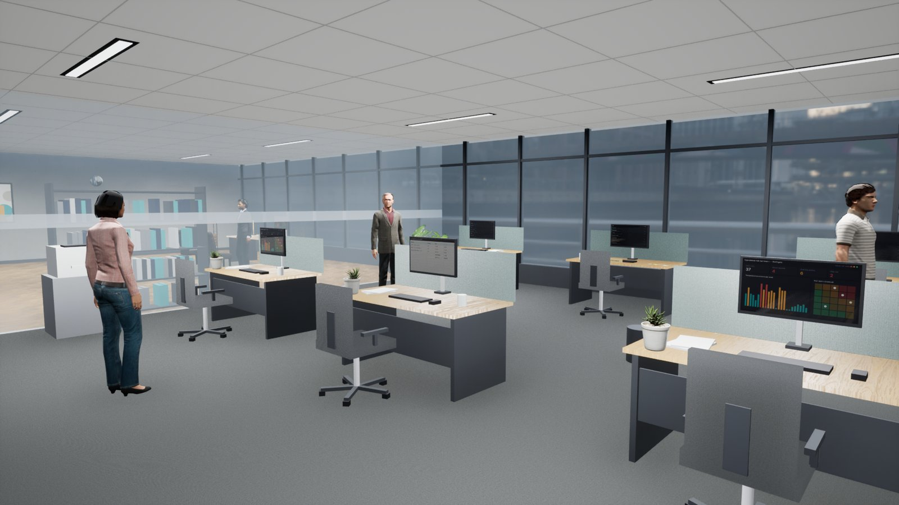
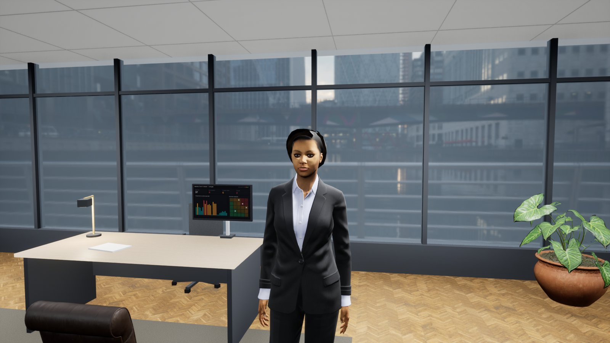
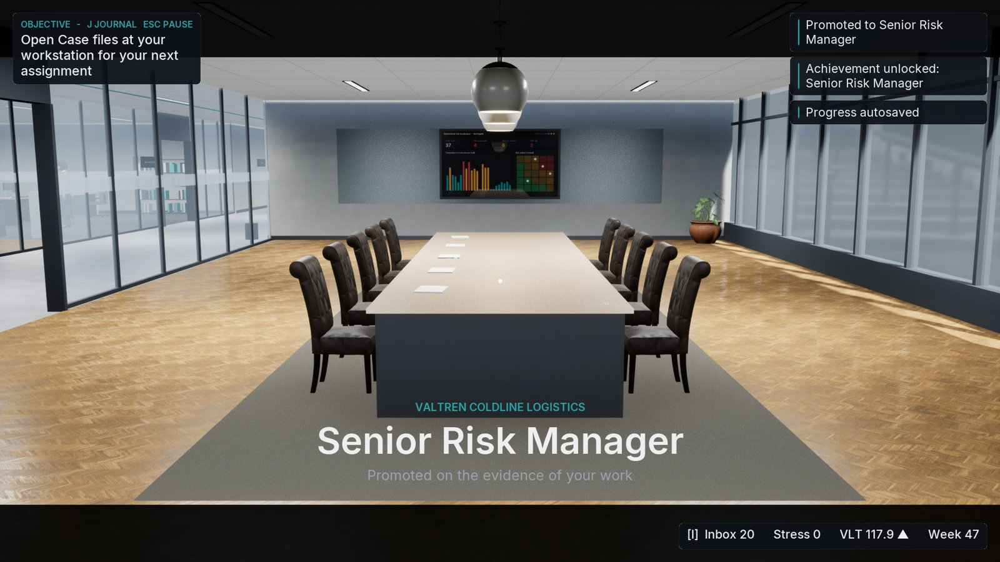
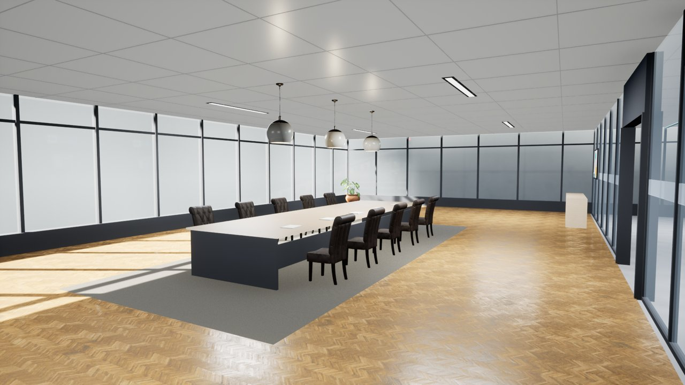
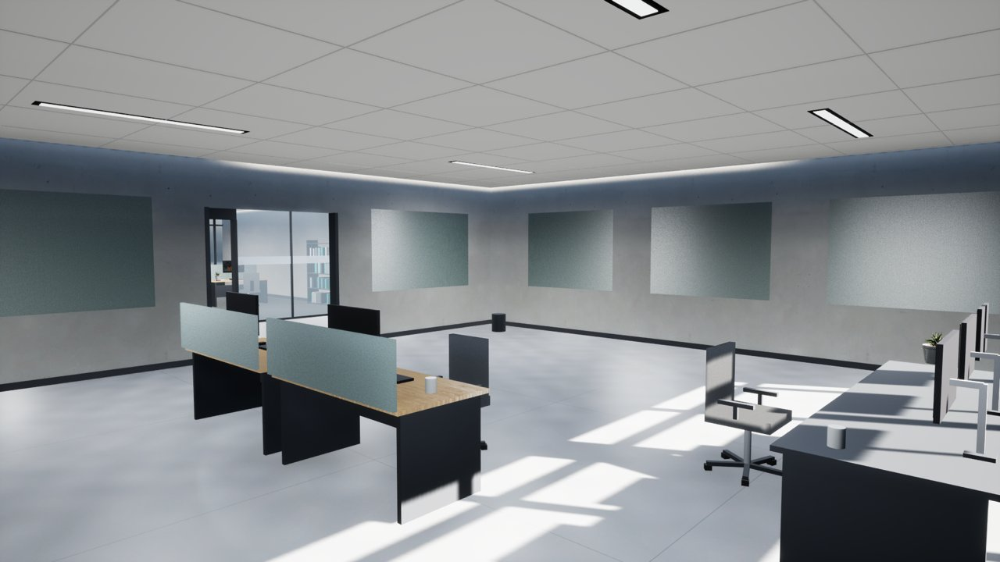
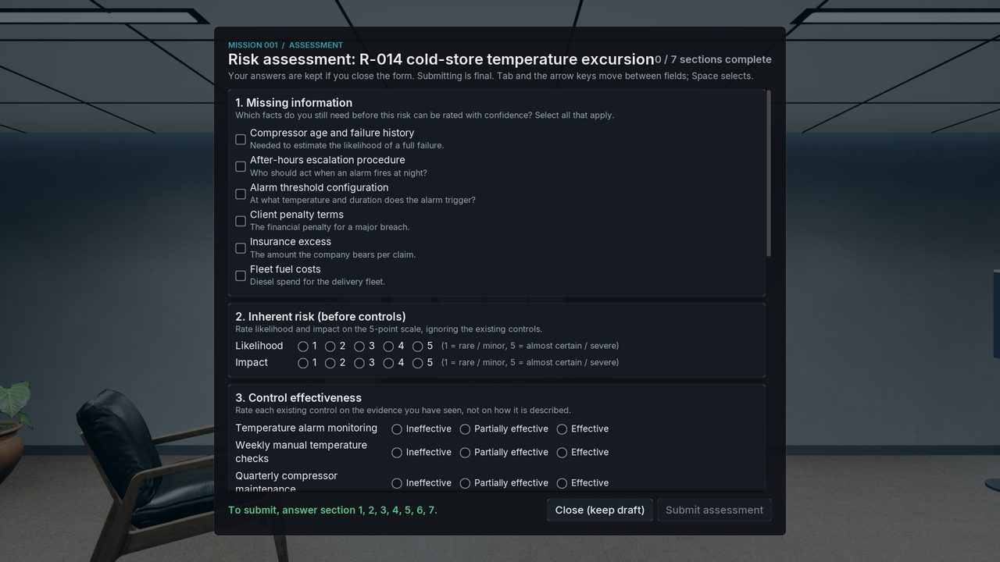
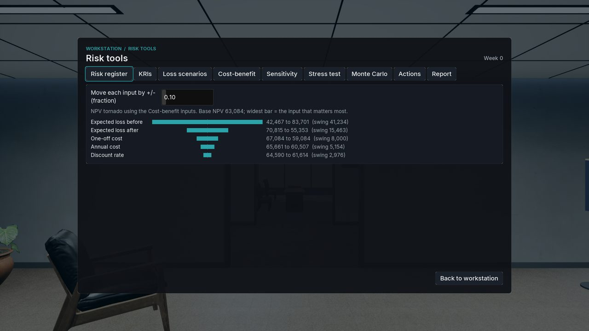
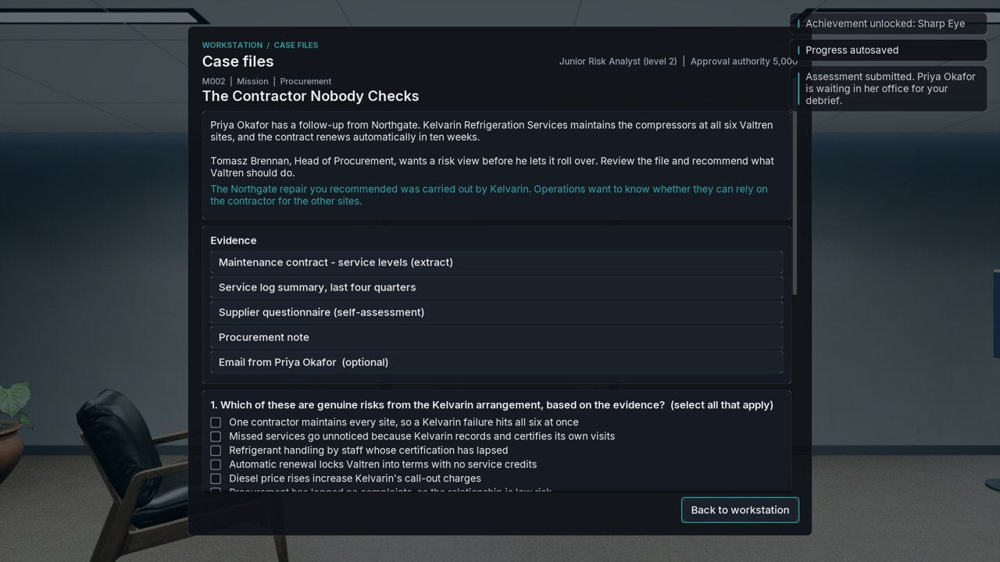
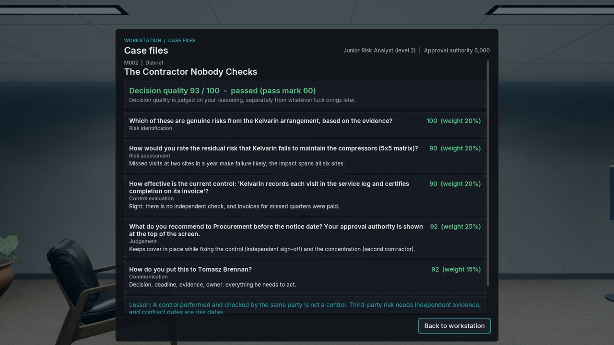

<div align="center">

# RISKBOUND

**From graduate to Chief Risk Officer, one real decision at a time.**

A first-person career simulator about risk management. Single-player and fully offline, built in Unreal Engine 5 for Windows.




</div>

---

## The pitch

You've just joined the risk team at **Valtren Coldline Logistics**, a (fictional) cold-chain company with six sites, a delivery fleet and a board that wants answers. On your first morning, Mission 001 drops on your desk: a temperature alarm at the Northgate cold store has been going off for weeks and nobody acted on it.

Walk the office, interview the people involved, find the evidence where it lives, rate the risk, judge the controls, recommend a treatment and defend it, in person at the boardroom lectern when it matters. Then live with what happens next, because Riskbound remembers. The contractor you let off the hook in one mission can cause the breakdown that opens a crisis weeks later, colleagues remember how you treated them, and the news crawl and share price react to your calls.

There are no quiz-show answers. You use the tools practitioners use: a risk register and heatmap, KRIs, expected loss, cost-benefit with NPV, sensitivity tornadoes, stress tests and Monte Carlo simulation. You're judged on the quality of your reasoning, not on luck.

## Features

| | |
|---|---|
| 🏢 **A real place to work** | Valtren HQ in first person: reception, analyst floor, manager's office, meeting room, training area, risk monitoring room and boardroom, with daylight, weather and realistic colleagues going about their day. Lumen lighting, playable on a GTX 1650. |
| 📁 **A full campaign** | 39 missions (six inspired by real events), 12 crises that escalate if you sit on them, and a Chief Risk Officer capstone presented to the board. Topics include third-party risk, KRIs, insurance, control testing, cyber, appetite, stress testing, audit, acquisitions, liquidity and regulators. |
| 🕵️ **A story underneath** | *The Corvane Ledger*: a fraud you uncover clue by clue across your career, alongside a mentor who may not be what she seems. |
| 👥 **People who remember you** | 15 characters with relationships that rise and fall, conversations with tones, an inbox of requests and favours with reply deadlines, stress and burnout, and the regulator. |
| 🧮 **Ten working risk tools** | Risk register with heatmap, KRI dashboard, loss scenarios, cost-benefit (NPV/ROI), sensitivity tornado, stress test, Monte Carlo, action tracker and an executive report you can export. Type the figures you calculate; you're scored on how close you get. Every formula lives in one place and is documented. |
| 🔗 **Consequences that last** | Weak answers leave latent risk that can surface weeks later, and the incident report names the decision. Incidents are seeded and reproducible; good controls make them rarer or smaller. |
| 🎓 **Promotion you earn** | Ten career levels, four starting backgrounds and ten skills. You're promoted on competence evidence and passed missions only; XP never buys a title. Each promotion gets its boardroom moment. |
| 🏁 **Endings and replay** | Eight endings decided by what you did, a performance review and an exportable certificate, what-if replays, Survival, Daily and Classroom modes with a local leaderboard, a 40-term glossary, photo mode and mission mods. |
| ♿ **Accessible** | Text size, reduced motion (cuts instead of camera moves), colour-safe palette, controller support with invert look, upscaling, frame cap and vsync, hints, volume and fully keyboard-navigable menus. |
| 🎵 **Sound** | Adaptive music that shifts with the pressure, office ambience, footsteps and interface sounds. |
| 💾 **Saves you can trust** | Automatic checkpoints, versioned and checksummed, with a backup that loads if the main save is damaged. Local only. |
| 🤖 **Optional AI colleagues** | Off by default. Switch it on with your own Anthropic API key to talk to colleagues in your own words. Everything else stays fully offline. |

## Screenshots

| | |
|---|---|
|  |  |
| *Your manager, Priya Okafor* | *Every promotion gets its boardroom moment* |
|  |  |
| *The executive boardroom* | *The risk monitoring room* |
|  |  |
| *Mission 001: the full risk assessment* | *Sensitivity tornado on a treatment's NPV* |
|  |  |
| *A case file: briefing, evidence and questions* | *The debrief, revealed only after you submit* |

## The career ladder

| Level | Role | Missions to pass before the next promotion |
|---:|---|---|
| 2 | Junior Risk Analyst *(you start here)* | M001 to M003 |
| 3 | Risk Analyst | M004 to M006 |
| 4 | Senior Risk Analyst | M007 to M009 |
| 5 | Supervisor / Team Lead | M010 to M012 |
| 6 | Risk Manager | M013 to M015 |
| 7 | Senior Risk Manager | M016 to M018 and crisis C001 |
| 8 | Head of Risk | M019 to M022 and crisis C002 |
| 9 | Director of Risk | M023 to M026 and crisis C003 |
| 10 | **Chief Risk Officer** | Your first board meeting: the capstone |

Passing missions isn't enough on its own. Each promotion also needs minimum competency scores; for example, you need Communication 45 or better to move up from Junior Risk Analyst. Full model: [Docs/CareerModel.md](Docs/CareerModel.md).

## Install and play

1. From [Releases](https://github.com/mutima89/riskbound/releases), get `Riskbound-Setup-1.1.0.exe` (installer, no admin rights needed) or `Riskbound-1.1.0-Win64-Portable.zip` (unzip and run `Riskbound.exe`). Check it against the `.sha256` file next to each download.
2. **Windows SmartScreen will warn "Unknown publisher"**, because the build isn't code-signed. Choose **More info, then Run anyway**. See `UNSIGNED-BUILD.txt` for details.
3. Uninstalling keeps your saves in `%LOCALAPPDATA%\Riskbound`.

**Requirements:** Windows 10/11 64-bit with a DirectX 12 GPU. Tested on a GeForce GTX 1650 at 1920x1080 on High. Use Low or Medium on weaker hardware.

**Controls:**
- WASD or arrow keys move, and the mouse looks around. A controller works too.
- **E** interacts, **J** opens the journal, **I** opens the inbox, **F12** toggles photo mode and **Esc** pauses.
- In menus, use Tab or the arrow keys to move, Enter or Space to select, and Esc to go back.

## Build from source

The game is split so the important logic can be tested without Unreal:

```
Source/RiskboundSim/   engine-independent C++17 rules: risk model, quant, career, missions, saves (deterministic, no RTTI or exceptions)
Source/Riskbound/      Unreal gameplay and UI: character, interaction, Slate screens, adapters into the sim
Data/Missions/         the campaign as validated JSON (format: Docs/MissionData.md)
Tests/Core/            simulation unit tests (CMake, run anywhere)
Docs/                  design, risk methodology, career model, save format, QA, release
```

**Simulation tests** (Linux, macOS or Windows; just CMake and a C++17 compiler):

```bash
Scripts/run_core_tests.sh          # Linux/macOS
Scripts\RunCoreTests.bat           # Windows
```

**The game** (Windows, Unreal Engine 5.8 and Visual Studio 2022 with the C++ workload):

```bat
set UE="C:\Program Files\Epic Games\UE_5.8"
%UE%\Engine\Build\BatchFiles\Build.bat RiskboundEditor Win64 Development -project="%CD%\Riskbound.uproject"
Scripts\RunUnrealTests.bat %UE%                     :: automation tests
Scripts\BuildWindows.bat %UE% Shipping              :: -> Release\Shipping\Windows\Riskbound.exe
Scripts\BuildInstaller.bat 1.1.0 1.1.0.0            :: installer + zip (needs Inno Setup 6)
```

The office cast (Microsoft Rocketbox avatars, MIT) isn't stored in the repository; without it the game falls back to the Unreal mannequin. To add it, run `python Scripts/FetchCharacters.py`, then `UnrealEditor.exe Riskbound.uproject -ExecutePythonScript=Scripts/ImportCharacters.py`.

Packaged self-tests: `Riskbound.exe -RbSelfTest=play`, then `-RbSelfTest=resume`. Release checklist: [Docs/Release.md](Docs/Release.md).

## How it's tested

- **95 simulation tests.** One plays the best answer to every question from Mission 001 to the capstone and checks promotion to CRO on competence alone. Others replay the whole campaign with random answers to prove it's deterministic, throw 4,000 damaged save files at the loader, and check every figure quoted in mission answers against the game's own formulas.
- **16 Unreal automation tests**, plus packaged self-tests (play, resume and a room tour with fps) on the Shipping build.
- **A scripted walkthrough** drives the Shipping build with real mouse and keyboard input from a new game to the CRO capstone, with save, quit and Continue. It checks that text fits, every case can be finished, and every promotion plays its boardroom ceremony.
- Every mission file is validated at load. Broken content fails the tests, so it can't ship.

Details: [Docs/TestingStrategy.md](Docs/TestingStrategy.md) and [Docs/QAReport.md](Docs/QAReport.md). The maths is in [Docs/RiskMethodology.md](Docs/RiskMethodology.md).

## Honest status

Version 1.1.0 is complete, passes every automated test and the full scripted walkthrough, and has been playtested by its creator. Still worth knowing:

- The build isn't code-signed, so Windows SmartScreen warns on first run.
- English only.
- Faces don't animate when characters speak; conversations happen on screen.

Full list: [Docs/KnownIssues.md](Docs/KnownIssues.md). Progress log: [Docs/Progress.md](Docs/Progress.md).

## A note on names

Every company, person and brand in Riskbound is fictional: Valtren Coldline Logistics, Kelvarin Refrigeration Services and the rest. Any resemblance to real organisations is coincidental.

## Credits

**Created by M A Almahlaki**
📧 m.awwadh.k@gmail.com · 💼 [LinkedIn](https://www.linkedin.com/in/mohammed-almahlaki001/)

- Built with Unreal Engine 5.8. Unreal is a trademark of Epic Games, Inc.
- Office cast and animations: Microsoft Rocketbox Avatar Library, copyright (c) 2020 Microsoft, MIT License.
- Music: "Clean Soul", "Thinking Music", "Lightless Dawn" and "Hitman" by Kevin MacLeod (incompetech.com), licensed under Creative Commons: By Attribution 4.0. Interface sounds: Kenney (CC0).
- Other third-party assets (CC0) and the Inter font (SIL OFL) are credited to their authors in [Docs/AssetCredits.md](Docs/AssetCredits.md).
- Development assistance: Claude Code by Anthropic.
- The same credits appear in the game (main menu and pause menu, then Credits). Look closely around the office, too.

## License

Code is MIT; see [LICENSE](LICENSE). Third-party assets keep their own licences, listed in [Docs/AssetCredits.md](Docs/AssetCredits.md).
